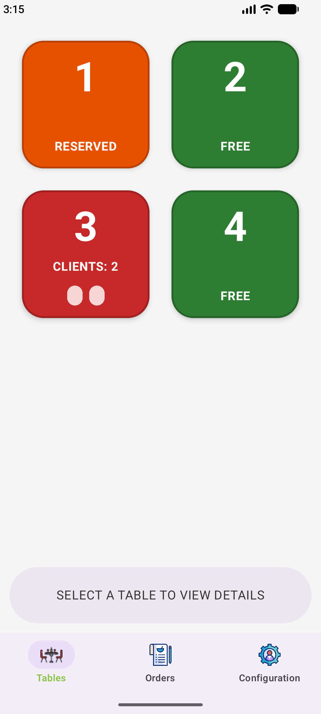
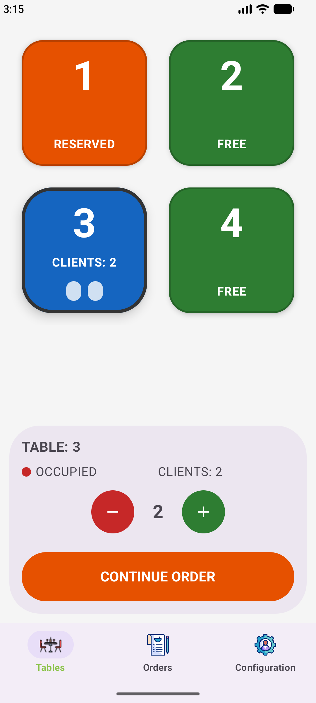
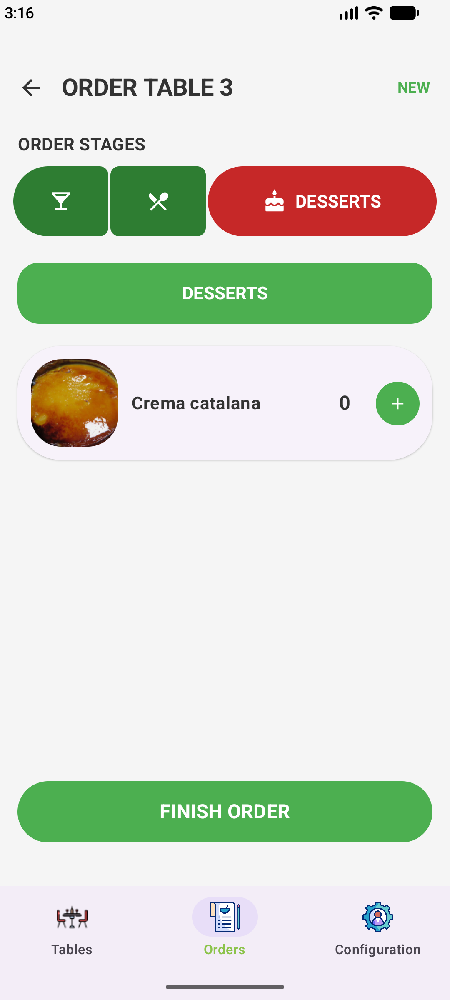
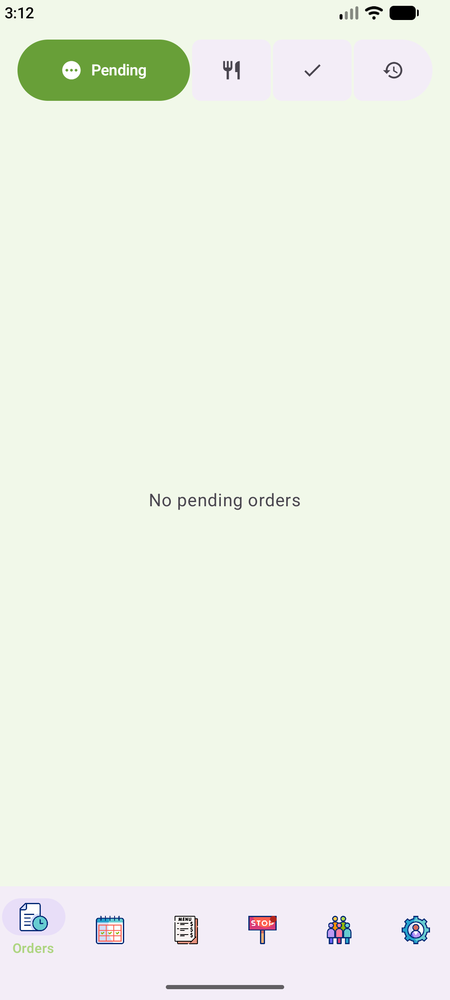
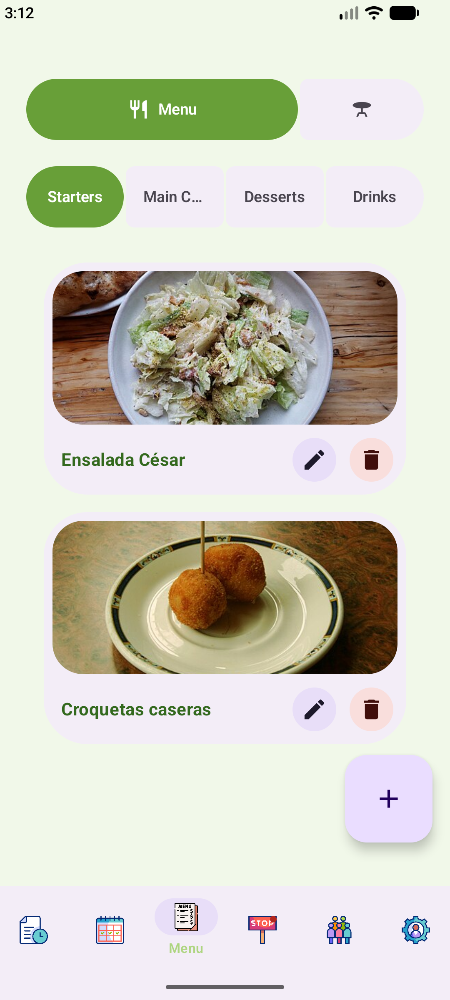
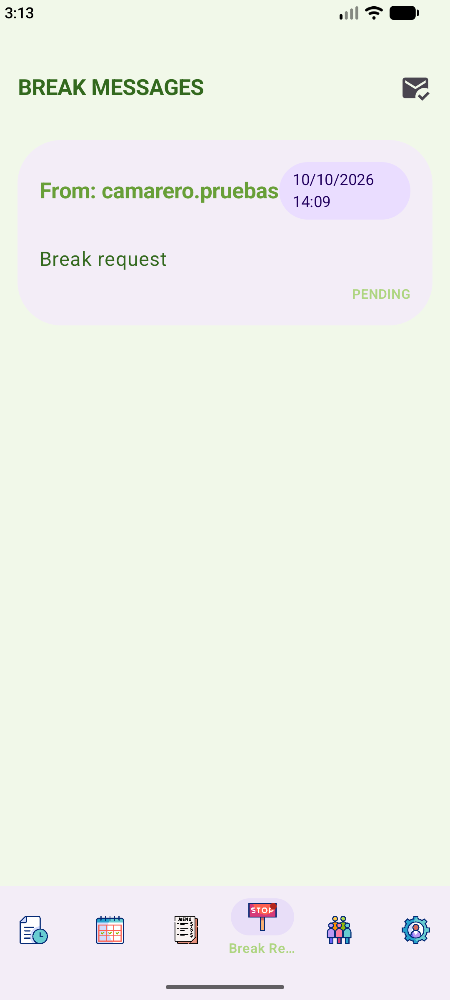
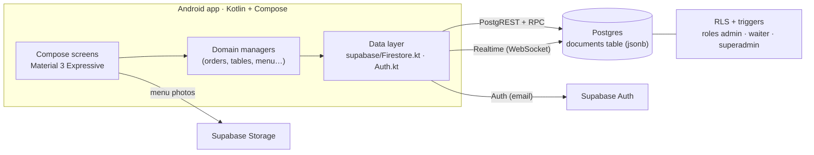

<div align="center">


# eTable

**Restaurant floor management for Android tablets: orders by course, a live table map and an admin panel.**

[](https://github.com/mad0021/etable-supabase/actions/workflows/ci.yml)


-3DDC84?logo=android&logoColor=white)


</div>

---

eTable digitises service in a restaurant: the waiter opens a table, takes the order course by course (starters & drinks → mains → desserts) and the kitchen receives it instantly; when a course is ready, the waiter's tablet is notified. The administrator manages the menu, tables, reservations, staff and break requests.

Built with **Kotlin** and **Jetpack Compose** (**Material 3 Expressive**) on **Supabase**: Postgres, Auth, Realtime and Storage.

## Screenshots

**Waiter**

| Tables | Table details | Order by course |
|:---:|:---:|:---:|
|  |  |  |

**Administration**

| Orders | Menu | Break requests |
|:---:|:---:|:---:|
|  |  |  |

## Features

**Waiter**
- Table map with live status (free · occupied · reserved) and number of guests.
- Orders by course with doneness and notes (voice dictation supported).
- *Order ready* alerts and text-to-speech.

**Administration**
- Orders in four columns (pending, in progress, ready, history) that update on their own.
- Menu with photos (Supabase Storage), tables, reservations and break requests.
- Staff management with per-user permissions and a **super administrator** enforced on the server.

**Everyone**
- Spanish, Catalan and English · 10 themes + dark mode · adjustable text size.
- Expressive motion that is turned off when the device has *Remove animations* enabled.

## Architecture



**Data layer.** Business logic works with a document model (collections, *listeners*, `Timestamp`), and [`supabase/Firestore.kt`](app/src/main/java/cat/dam/mamadou/etable/supabase/Firestore.kt) implements it on Supabase: each document is a row in `documents(collection, id, data jsonb)`, queries are translated into PostgREST filters, changes arrive over a single self-reconnecting Realtime channel, and `update()` with nested paths (`stages.SEGONS.ready`) is an atomic SQL function.

## Security

Security does not depend on the app: Postgres enforces it.

- **Row Level Security** on every operation: active staff operate tables and orders; menu and users are admin-only; only an admin can delete sales history and break requests.
- **Guard triggers**: a waiter cannot change their own role or permissions or approve their own break; only the super administrator can manage other administrators.
- **User creation through a `SECURITY DEFINER` RPC** with validation, without exposing the *service key*; users created outside the app stay inactive until an admin enables them.
- **Sign-in verifies the role** against the database.
- On the device: no backups of the session, no keys in the source code, minimal permissions, and debug logs stripped from *release* builds (R8).
- [`supabase/check.mjs`](supabase/check.mjs) tests these rules against an in-memory Postgres (PGlite) on every *push*.

## Tech stack

| Layer | |
|---|---|
| Language | Kotlin 2.4 |
| UI | Jetpack Compose · Material 3 Expressive (1.5) · Coil |
| Backend | Supabase: Postgres, Auth, Realtime, Storage · supabase-kt 3.8 · Ktor |
| Build | Gradle 9.5 · AGP 9.1 · R8 (*release* APK ≈ 8 MB) |
| Quality | GitHub Actions: app build + SQL/RLS tests |

## Getting started

**Requirements:** a recent Android Studio, JDK 17+ and Android SDK Platform 37.

1. **Create a [Supabase](https://supabase.com) project** and run these in the *SQL Editor*, in order:
   - [`supabase/schema.sql`](supabase/schema.sql): table, functions, RLS, Realtime and sample data.
   - [`supabase/002_seguridad.sql`](supabase/002_seguridad.sql): security hardening. First replace `YOUR_ADMIN_EMAIL@example.com` with your admin account's email.
2. In *Authentication → Providers*, turn off **Allow new users to sign up** (admins create staff accounts from the app).
3. Create your user in *Authentication → Users* and make it an admin:
   ```sql
   update documents set data = data || '{"role":"admin","isActive":true}'
   where collection = 'user' and data->>'email' = 'you@example.com';
   ```
4. Copy the URL and the *publishable key* (*Project Settings → API Keys*) into `local.properties`:
   ```properties
   SUPABASE_URL=https://xxxx.supabase.co
   SUPABASE_ANON_KEY=sb_publishable_...
   ```
5. Open the project in Android Studio and run it. It is designed for **tablets**, and also works on phones.

**Schema tests**

```bash
cd supabase && npm install && npm test
```

## Project structure

```
app/src/main/java/cat/dam/mamadou/etable/
├── supabase/          Data layer on Supabase (documents, Realtime, Auth)
├── utils/firebase/    Domain managers (orders, tables, menu, reservations, users, breaks)
├── ui/theme/          Expressive theme, shapes, typography, motion and status colours
├── ui/components/     Notifications, dialogs and shared components
└── ui/screens/        auth · waiter · admin
supabase/              schema.sql · 002_seguridad.sql · check.mjs (RLS tests)
```

## Author

**Mamadou Diallo Ndoye** · [GitHub](https://github.com/mad0021)

[MIT](LICENSE) licence. Sample dish photos come from Wikimedia Commons; see the [credits](app/src/main/assets/menu/CREDITS.txt).
